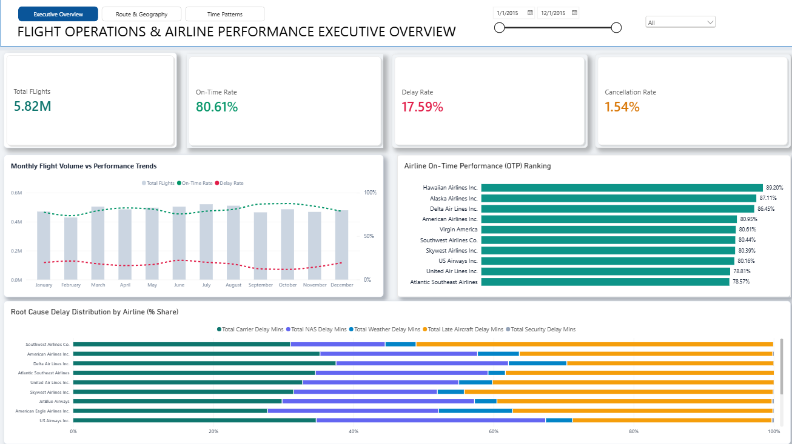
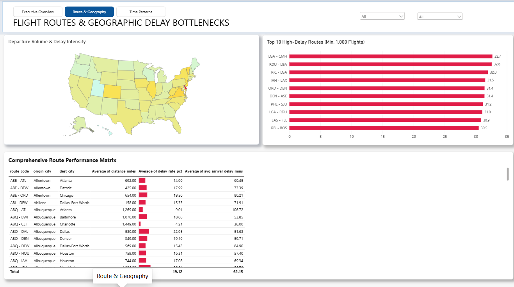
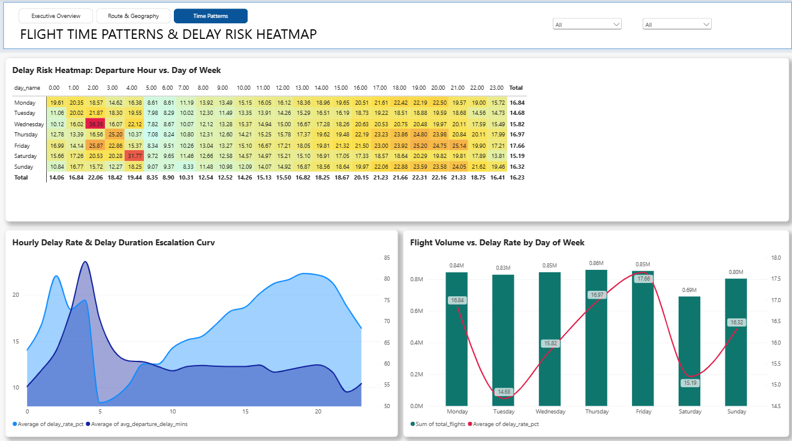

# US Airline Flight Operations & Delay Risk Intelligence Dashboard

An end-to-end operational intelligence dashboard built with **Power BI**, backed by a PostgreSQL analytics layer, analyzing **5.82 million U.S. domestic flights in 2015** to surface on-time performance gaps, route bottlenecks, delay root causes, and time-of-day risk patterns.

**Stack:** Power BI · DAX · PostgreSQL 15+ · DBeaver · CSV reference data



---

## Table of Contents

- [Executive Summary](#executive-summary)
- [Business Context and Scope](#business-context-and-scope)
- [Data Dictionary and Metric Definitions](#data-dictionary-and-metric-definitions)
- [Architecture and Pipeline](#architecture-and-pipeline)
- [Dashboard Walkthrough](#dashboard-walkthrough)
  - [Page 1: Executive Overview](#page-1-executive-overview)
  - [Page 2: Route and Geography](#page-2-route-and-geography)
  - [Page 3: Time Patterns and Delay Risk](#page-3-time-patterns-and-delay-risk)
- [Key Findings](#key-findings)
- [Recommendations](#recommendations)
- [Limitations and Future Work](#limitations-and-future-work)
- [Tech Stack](#tech-stack)
- [Repository Structure](#repository-structure)
- [How to Use](#how-to-use)
- [Color Palette](#color-palette)
- [Conclusion](#conclusion)
- [Version Note](#version-note)

---

## Executive Summary

The dashboard covers **5.82M scheduled flights** in **January–December 2015**, with reference data for **14 carriers** and **322 airports** in the United States and its territories.

| Metric | Value |
|---|---:|
| Total flights analyzed | **5.82M** |
| On-time rate (OTP) | **80.61%** |
| Delay rate | **17.59%** |
| Cancellation rate | **1.54%** |
| Period | January–December 2015 |
| Reference carriers | 14 |
| Reference airports | 322 |
| Primary delay drivers | Carrier delay and late-aircraft delay |

> The three KPI rates sum to 99.74%. The remaining **~0.26 percentage points** are not represented in these cards and are consistent with diverted flights. Confirm the exact status mapping in the ETL before using the residual as a diverted-flight rate.

### Headline Insights

- **Delay risk compounds through the operating day.** The hourly delay rate rises from a **05:00–07:00 trough of 8.35%–10.31%** to a **17:00–21:00 peak of 21.23%–22.31%**, roughly **2.7×** higher. This pattern is consistent with late-aircraft and turnaround delays propagating across successive rotations.
- **Friday is the highest-risk day, not the highest-volume day.** Friday records a **17.66%** delay rate, while Tuesday is the most stable at **14.68%**. The weekly spread is **2.98 percentage points**.
- **Risk is concentrated in a small set of hubs and routes.** Four of the ten highest-delay routes involve **New York LaGuardia (LGA)**, and **Denver (DEN)** appears twice. The top route, **LGA → CMH**, reaches a **32.7%** delay rate with at least 1,000 flights.
- **Carrier and late-aircraft delay minutes dominate the root-cause mix.** In the 100% stacked bar, these two categories account for the largest share of delay minutes for most carriers; NAS and weather are secondary, and security is negligible.
- **Airline performance varies widely.** **Hawaiian (89.20%)**, **Alaska (87.11%)**, and **Delta (86.45%)** lead the OTP ranking. **Frontier (74.02%)** is reported as the lowest performer in the full ranking, a gap of about **15 percentage points** versus Hawaiian.
- **Three delay rates appear in the dashboard for good reason.** The KPI delay rate is **17.59%**, the time-pattern heatmap totals **16.23%**, and the route matrix totals **19.12%**. They use different scopes, denominators, and grains; they should not be compared as if they were the same metric.

---

## Business Context and Scope

### Problem

Flight delays are not evenly distributed across an airline network. They cluster by carrier, route, airport, day, and departure hour, and they can propagate from one rotation to the next. A network-level average hides the operational pressure points where intervention has the highest leverage.

### Objective

Turn 5.82M flight-level records into a decision-support view that answers four questions:

1. **Where** are delays concentrated by airline, route, and geography?
2. **When** does delay risk escalate by day of week and departure hour?
3. **Why** do delays occur across the five BTS delay-cause categories?
4. **What** operational levers can reduce delay exposure?

### Intended Users

- Network operations and dispatch teams
- Airport and station operations managers
- Crew and aircraft scheduling teams
- Revenue management and network planning
- Data and BI teams maintaining the analytics layer

### Data Source and Coverage

| Item | Detail |
|---|---|
| Source | U.S. Department of Transportation, Bureau of Transportation Statistics (BTS), Airline On-Time Performance |
| Extract used | 2015 flight-level data, distributed as the Kaggle dataset **2015 Flight Delays and Cancellations** |
| Flight records | **5.82M** |
| Reference carriers | 14 (`Data/airlines.csv`) |
| Reference airports | 322 (`Data/airports.csv`) |
| Geography | United States and its territories |
| Period | January–December 2015 |
| Raw flight file | `flights.csv` is **not committed** to this repository because of its size |

The dashboard date slicer is displayed as **1/1/2015–12/1/2015**; the monthly visuals include December 2015.

### Scope Boundaries

- The analysis is **descriptive and diagnostic**, not causal. It identifies associations and pressure points; it does not prove that a specific intervention will produce a specific outcome.
- The dataset is a **2015 snapshot**. The patterns are useful for methodology and historical benchmarking, but they are not a substitute for a current operational view.
- The Power BI report uses **pre-aggregated analytics marts**; the raw 5.82M-row flight table is not embedded in the `.pbix`.

---

## Data Dictionary and Metric Definitions

### Staging Layer: `staging.flights`

Key fields used by the dashboard:

| Field | Description |
|---|---|
| `airline_name` | Operating carrier name |
| `origin_airport` | Departure airport code |
| `destination_airport` | Arrival airport code |
| `scheduled_departure` | Scheduled departure time, encoded as HHMM |
| `departure_delay` | Departure delay in minutes |
| `arrival_delay` | Arrival delay in minutes |
| `flight_status` | Flight outcome used for delay analysis (e.g., `DELAYED`) |
| `is_cancelled` | Cancellation flag |
| `day_of_week` | Numeric day of week (1 = Monday, 7 = Sunday) |
| `distance_miles` | Route distance |
| Delay-cause minutes | Carrier, NAS, weather, late-aircraft, and security delay minutes |

The staging table is the flight-level source for all downstream aggregations. Exact physical column names may differ slightly from the conceptual names above; use the ETL definitions as the source of truth.

### Analytics Marts

| Mart | Grain | Primary Dashboard Use |
|---|---|---|
| `analytics.airline_monthly_summary` | Airline × month | KPI cards, monthly trend, OTP ranking, root-cause distribution |
| `analytics.route_performance` | Origin–destination route | State map, Top 10 routes, route performance matrix |
| `analytics.time_pattern_analysis` | Airline × origin × day × hour | Delay-risk heatmap, hourly escalation curve, day-of-week comparison |

Power BI entity names may differ from the database schema and table names. The schema/table notation above is used as the reference for readability.

### Metric Definitions

| Metric | Definition | Important Note |
|---|---|---|
| `Total Flights` | Scheduled flights in scope | Used in KPI cards, monthly volume, and day-of-week volume |
| `On-Time Rate` | Share of operated flights classified as on time | The standard BTS definition uses an arrival delay threshold of 15 minutes; confirm the ETL's `flight_status` mapping |
| `Delay Rate` (KPI) | Delayed flights ÷ scheduled flights × 100 | Overall card value: **17.59%** |
| `Cancellation Rate` | Cancelled flights ÷ scheduled flights × 100 | Overall card value: **1.54%** |
| `Delay Rate` (time patterns) | Delayed flights ÷ non-cancelled departures × 100 | Overall heatmap value: **16.23%**; uses the time-pattern mart's scope and hour aggregation, so it is not directly comparable to the KPI |
| `Route Delay Rate` | Delayed flights on a route ÷ total flights on that route × 100 | Route matrix total is an **unweighted average of route-level rates**: **19.12%** |
| `Avg Arrival Delay` | Mean arrival delay in minutes among delayed flights | Route matrix total: **62.15 minutes** |
| Delay-cause share | Category delay minutes ÷ total delay minutes × 100 | Used in the 100% stacked bar by airline |

### Why Three Delay Rates Differ

The dashboard intentionally exposes delay risk at three grains:

- **17.59% — executive KPI.** Flight-level delay rate across the full monthly summary scope.
- **16.23% — time-pattern mart.** Uses the mart's departure-hour scope and excludes cancellations; this is the rate shown in the heatmap. Its overall value is not directly comparable to the flight-level KPI because the scope and aggregation differ.
- **19.12% — route matrix.** A simple average of route-level delay rates; high-delay routes receive the same weight as high-volume routes.

For external reporting, use **one flight-weighted delay-rate definition** and state it explicitly. The three figures are useful for relative screening, not for mixing into a single headline.

---

## Architecture and Pipeline

### Data Flow

```text
2015 flight records (5.82M)
            |
            v
PostgreSQL staging layer
staging.flights
            |
            +---------------------------+---------------------------+---------------------------+
            |                           |                           |
            v                           v                           v
analytics.airline_monthly_summary  analytics.route_performance  analytics.time_pattern_analysis
            |                           |                           |
            +---------------------------+---------------------------+---------------------------+
                                        |
                                        v
                          Power BI semantic model
                          (DAX measures and relationships)
                                        |
                    +-------------------+-------------------+
                    |                   |                   |
                    v                   v                   v
            Executive Overview   Route & Geography   Time Patterns
```

### Lineage Summary

| Source | Transformation | Mart |
|---|---|---|
| `staging.flights` | Aggregate by airline and month; calculate OTP, delay, cancellation, and delay-cause minutes | `analytics.airline_monthly_summary` |
| `staging.flights` | Aggregate by origin–destination route; calculate volume, distance, delay rate, and average arrival delay | `analytics.route_performance` |
| `staging.flights` | Aggregate by airline, origin, day of week, and departure hour; exclude cancellations | `analytics.time_pattern_analysis` |

### Representative SQL View

The following view illustrates how the time-pattern mart is constructed. It is a representative example; adjust names, casts, and filters to match the production ETL.

```sql
CREATE OR REPLACE VIEW analytics.v_time_pattern_analysis AS
SELECT
    f.airline_name,
    f.origin_airport,
    f.day_of_week,
    CASE f.day_of_week
        WHEN 1 THEN 'Monday'
        WHEN 2 THEN 'Tuesday'
        WHEN 3 THEN 'Wednesday'
        WHEN 4 THEN 'Thursday'
        WHEN 5 THEN 'Friday'
        WHEN 6 THEN 'Saturday'
        WHEN 7 THEN 'Sunday'
    END AS day_name,
    (f.scheduled_departure / 100)::INT AS departure_hour,
    COUNT(*) AS total_flights,
    COUNT(*) FILTER (
        WHERE f.flight_status = 'DELAYED'
    ) AS delayed_flights,
    ROUND(
        COUNT(*) FILTER (
            WHERE f.flight_status = 'DELAYED'
        ) * 100.0 / NULLIF(COUNT(*), 0),
        2
    ) AS delay_rate_pct,
    ROUND(
        AVG(f.departure_delay) FILTER (
            WHERE f.flight_status = 'DELAYED'
        ),
        2
    ) AS avg_departure_delay_mins,
    ROUND(
        AVG(f.arrival_delay) FILTER (
            WHERE f.flight_status = 'DELAYED'
        ),
        2
    ) AS avg_arrival_delay_mins
FROM staging.flights AS f
WHERE f.is_cancelled = FALSE
  AND f.scheduled_departure IS NOT NULL
GROUP BY
    f.airline_name,
    f.origin_airport,
    f.day_of_week,
    (f.scheduled_departure / 100)::INT;
```

### Power BI Measures

| Measure | Used In | Purpose |
|---|---|---|
| `Total Flights` | KPI cards, monthly trend, day-of-week chart | Flight volume |
| `On-Time Rate` | KPI card, airline ranking, monthly trend | On-time performance |
| `Delay Rate` | KPI card, monthly trend, day-of-week chart | Delay incidence |
| `Cancellation Rate` | KPI card | Cancellation incidence |
| `Total Carrier Delay Mins` | Root-cause stacked bar | Carrier-controlled delay share |
| `Total NAS Delay Mins` | Root-cause stacked bar | Air-traffic/airport-system delay share |
| `Total Weather Delay Mins` | Root-cause stacked bar | Extreme-weather delay share |
| `Total Late Aircraft Delay Mins` | Root-cause stacked bar | Late-aircraft propagation share |
| `Total Security Delay Mins` | Root-cause stacked bar | Security-related delay share |
| `Top Route Delay Rate` | Top 10 routes | Rank routes with at least 1,000 flights |

---

## Dashboard Walkthrough

### Page 1: Executive Overview


**Purpose:** Provide a macro view of network health and the delay-cause mix.

| Visual | Fields | What It Answers |
|---|---|---|
| KPI cards | `Total Flights`, `On-Time Rate`, `Delay Rate`, `Cancellation Rate` | How is the network performing overall? |
| Monthly Flight Volume vs Performance Trends | `flight_month`, `Total Flights` (columns), `On-Time Rate` and `Delay Rate` (lines) | Is performance changing with monthly volume? |
| Airline On-Time Performance (OTP) Ranking | `airline_name`, `On-Time Rate` | Which carriers lead and lag? |
| Root Cause Delay Distribution by Airline (% Share) | `airline_name`, five delay-cause measures | Which delay mechanisms dominate for each carrier? |

**Slicers:** airline and flight month.

**How to read it:** Start with the four KPI cards, then compare the monthly performance lines against volume. Use the ranking to identify the performance spread, and use the 100% stacked bar to separate carrier-controlled delays from late-aircraft propagation, NAS, weather, and security.

---

### Page 2: Route and Geography



**Purpose:** Locate spatial bottlenecks and route-level risk.

| Visual | Fields | What It Answers |
|---|---|---|
| Departure Volume and Delay Intensity map | `origin_state`, `Sum(delay_rate_pct)`; tooltips: `Total Flights`, delay rate, origin airport name | Which states show elevated delay intensity? |
| Top 10 High-Delay Routes (Min. 1,000 Flights) | `route_code`, `Top Route Delay Rate`; tooltips: `Total Flights`, average arrival delay | Which high-volume corridors are most delayed? |
| Comprehensive Route Performance Matrix | `route_code`, `origin_city`, `dest_city`, `distance_miles`, `delay_rate_pct`, `avg_arrival_delay_mins` | Which routes combine high delay with long arrival delays? |

**Slicers:** destination state and destination city.

**How to read it:** The map is a screening tool: it colors origin states by the **sum of route-level delay rates**, so a state with many routes can appear more intense even if its individual routes are not unusually delayed. The Top 10 chart applies a **1,000-flight minimum** to suppress low-volume noise. Use the matrix for granular route comparisons, and remember that its total row is an unweighted route average.

---

### Page 3: Time Patterns and Delay Risk



**Purpose:** Reveal intraday and weekly delay-risk patterns.

| Visual | Fields | What It Answers |
|---|---|---|
| Delay Risk Heatmap: Departure Hour vs. Day of Week | `day_name` (rows), `departure_hour` (columns), `delay_rate_pct` | When during the week is delay risk highest? |
| Hourly Delay Rate and Delay Duration Escalation Curve | `departure_hour`, `delay_rate_pct` (primary), `avg_departure_delay_mins` (secondary) | How do delay incidence and delay duration evolve through the day? |
| Flight Volume vs. Delay Rate by Day of Week | `day_of_week`, `Total Flights` (columns), `delay_rate_pct` (line) | Does delay risk rise with volume? |

**Slicers:** airline and origin airport.

**How to read it:** The heatmap uses a three-color gradient from teal (lower risk) through yellow (moderate) to rose red (higher risk). The hourly curve is best read together with the heatmap: the rate and duration lines show different dimensions of the same operating-day pattern. The day-of-week chart shows that volume and delay risk are related but not identical.

---

## Key Findings

### 1. Overall Performance Is Strong but Not Uniform

The network records **5.82M flights**, **80.61% OTP**, **17.59% delay**, and **1.54% cancellation**. The three percentages leave a **~0.26 pp** residual that is consistent with diverted flights.

Monthly volume stays in a relatively narrow band of approximately **0.46M–0.50M flights per month**, while OTP and delay lines remain within a similarly narrow range. The monthly view is therefore better for monitoring stability than for claiming dramatic seasonality.

### 2. Delay Risk Cascades Through the Operating Day

The hourly delay-rate profile has three distinct features:

- A **late-night hump** between **02:00 and 04:00** (18.42%–22.06%), when volume is low and the remaining flights are more likely to be severely delayed.
- A **clean early-morning window** between **05:00 and 07:00** (8.35%–10.31%), the lowest-risk departure period.
- An **evening peak** between **17:00 and 21:00** (21.23%–22.31%), roughly **2.7×** the 05:00 trough.

The evening pattern is consistent with accumulated turnaround delays and late-aircraft propagation across successive rotations. The analysis is descriptive; it does not isolate the causal contribution of each mechanism.

| Hour | Delay Rate |
|---|---:|
| 00:00 | 14.06% |
| 02:00 | 22.06% |
| 03:00 | 18.42% |
| 05:00 | 8.35% |
| 06:00 | 8.90% |
| 07:00 | 10.31% |
| 08:00 | 12.54% |
| 12:00 | 15.50% |
| 16:00 | 20.15% |
| 17:00 | 21.23% |
| 18:00 | 21.66% |
| 19:00 | 22.31% |
| 20:00 | 22.16% |
| 21:00 | 21.33% |
| 23:00 | 16.41% |
| **Overall** | **16.23%** |

<details>
<summary>Full 24-hour delay-rate profile</summary>

| Hour | Delay Rate |
|---|---:|
| 00:00 | 14.06% |
| 01:00 | 16.84% |
| 02:00 | 22.06% |
| 03:00 | 18.42% |
| 04:00 | 19.44% |
| 05:00 | 8.35% |
| 06:00 | 8.90% |
| 07:00 | 10.31% |
| 08:00 | 12.54% |
| 09:00 | 12.52% |
| 10:00 | 14.26% |
| 11:00 | 15.13% |
| 12:00 | 15.50% |
| 13:00 | 16.82% |
| 14:00 | 18.25% |
| 15:00 | 18.67% |
| 16:00 | 20.15% |
| 17:00 | 21.23% |
| 18:00 | 21.66% |
| 19:00 | 22.31% |
| 20:00 | 22.16% |
| 21:00 | 21.33% |
| 22:00 | 18.75% |
| 23:00 | 16.41% |
| **Overall** | **16.23%** |

</details>

### 3. Friday Is the Weekly Pressure Point

| Day | Flight Volume | Delay Rate |
|---|---:|---:|
| Monday | 0.84M | 16.84% |
| Tuesday | 0.83M | **14.68%** |
| Wednesday | 0.85M | 15.82% |
| Thursday | **0.86M** | 16.97% |
| Friday | 0.85M | **17.66%** |
| Saturday | **0.69M** | 15.19% |
| Sunday | 0.80M | 16.32% |
| **All week** | — | **16.23%** |

Friday has the highest delay rate despite not having the highest volume; Thursday carries the most flights but performs better. Saturday has the lowest volume and a below-average delay rate, but Tuesday is the most stable day overall. Volume alone does not explain delay risk.

### 4. Hub and Route Risk Is Concentrated

The ten highest-delay routes, each with at least 1,000 flights:

| Rank | Route | Delay Rate |
|---:|---|---:|
| 1 | LGA → CMH | **32.7%** |
| 2 | RDU → LGA | **32.6%** |
| 3 | RIC → LGA | **32.0%** |
| 4 | IAH → LAX | 31.5% |
| 5 | ORD → DEN | 31.4% |
| 6 | DEN → ASE | 31.4% |
| 7 | PHL → SJU | 31.2% |
| 8 | LGA → RDU | 31.0% |
| 9 | LAS → FLL | 30.9% |
| 10 | PBI → BOS | 30.5% |

**LGA** appears in four of the ten routes, and **DEN** appears twice. The concentration points to hub congestion and Northeast-corridor pressure rather than a uniformly distributed network problem. The route matrix total is **19.12%** delay rate and **62.15 minutes** average arrival delay, but this is an unweighted route-level average, not the flight-weighted network rate.

### 5. Carrier and Late-Aircraft Delays Dominate

The root-cause chart decomposes delay minutes into five BTS categories:

| Category | What It Captures | Operational Lever |
|---|---|---|
| Carrier | Airline-controlled issues such as crew, maintenance, boarding, and servicing | Readiness, staffing, turnaround execution |
| NAS | Air-traffic control, airport operations, and non-extreme weather | Airspace and airport capacity coordination |
| Weather | Extreme weather | Schedule resilience and recovery planning |
| Late Aircraft | Delay inherited from the aircraft's previous rotation | Turnaround buffers, spare aircraft, rotation design |
| Security | Security-related disruption | Security operations and contingency planning |

In the stacked chart, **Carrier** and **Late Aircraft** together account for roughly **70%–80% of delay minutes for many carriers**. NAS and Weather are secondary, and Security is negligible. Late-aircraft delay is best understood as a propagation mechanism: it transfers delay from an earlier rotation into a later one, which is why the evening peak is more pronounced than the morning trough. Exact category percentages should be read from the visual tooltips or an exported table.

### 6. Airline Performance Spread Is Wide

| Carrier | On-Time Rate |
|---|---:|
| Hawaiian Airlines | **89.20%** |
| Alaska Airlines | **87.11%** |
| Delta Air Lines | **86.45%** |
| American Airlines | 80.95% |
| Virgin America | 80.61% |
| Southwest Airlines | 80.44% |
| SkyWest Airlines | 80.39% |
| US Airways | 80.16% |
| United Airlines | 78.81% |
| Atlantic Southeast Airlines | **78.57%** |
| Frontier Airlines | **74.02%**\* |

\* Frontier's 74.02% comes from the full ranking. The preview screenshot shows the top 10 carriers; Frontier is not visible in the cropped view. The lowest visible carrier is Atlantic Southeast at 78.57%.

The visible spread is **10.63 percentage points** between Hawaiian and Atlantic Southeast, widening to about **15 percentage points** if Frontier is included. The ranking is a useful starting point for benchmarking, but it should be paired with route mix, network structure, and operating conditions before drawing conclusions about carrier quality.

### 7. The Three Delay Rates Are Not Interchangeable

| View | Delay Rate | Why It Differs |
|---|---:|---|
| Executive KPI | **17.59%** | Flight-level delay rate across the monthly summary scope |
| Time-pattern heatmap | **16.23%** | Uses the time-pattern mart's scope and hour-level aggregation; not directly comparable to the KPI |
| Route matrix | **19.12%** | Unweighted average of route-level rates; small and large routes receive equal weight |

This is a feature of the analysis, not a contradiction. The important discipline is to **state the denominator** whenever a delay rate is quoted. For a single headline, use the flight-weighted KPI; for route triage, use the route matrix; for temporal patterns, use the heatmap.

---

## Recommendations

| Priority | Recommendation | Rationale | Owner | KPI / Expected Impact | Timeframe |
|---|---|---|---|---|---|
| **P1** | Extend turnaround buffers by **15–20 minutes** for departures after 16:00 at LGA, ORD, and DEN. | The evening peak and the dominant late-aircraft share point to rotation-driven propagation. | Network Operations / Station Operations | Lower 17:00–21:00 delay rate and late-aircraft minutes | Next schedule season |
| **P1** | Build recovery capacity on Northeast-corridor routes: LGA–CMH, RDU–LGA, RIC–LGA, and LGA–RDU. | Four of the ten highest-delay routes involve LGA; these are high-volume, high-risk corridors. | Operations Control Center | Route delay rate, completion factor, recovery time | 0–90 days |
| **P2** | Add reserve aircraft and on-call ground crew for Friday afternoon departure banks; cover Thursday and Monday as secondary peaks. | Friday is the highest-delay day; Thursday carries the most volume; Monday is also above average. | Operations Control Center / Station Operations | Friday delay rate, staffing coverage, reserve utilization | Weekly |
| **P2** | Attack carrier-controlled delay with maintenance readiness, crew readiness, and turnaround choreography; add spare aircraft where late-aircraft propagation is highest. | Carrier and late-aircraft categories dominate delay minutes. | Technical Operations / Cabin Operations | Carrier delay minutes, late-aircraft minutes | 1–2 quarters |
| **P3** | Incentivize departures in the **05:00–07:00** window rather than shifting demand into the late-night 02:00–04:00 window. | Early morning has the lowest delay rate; late-night has elevated risk and sparse volume. | Revenue Management / Network Planning | Peak-to-off-peak delay spread, load factor | Next season |
| **P3** | Standardize measurement: use flight-weighted state and route rates, align denominators, and refresh the dataset. | The map, route matrix, and heatmap currently answer different questions with different weights. | Data / BI | Metric consistency, data freshness | 30–60 days |

**Execution note:** Treat these as hypotheses to validate with a pilot. The dashboard shows associations; before a network-wide change, compare a treatment station or route against a control group and monitor OTP, delay minutes, completion factor, and cost.

---

## Limitations and Future Work

### Limitations

- **Historical snapshot.** The data covers 2015 only. It is useful for methodology and historical benchmarking, not for current operational decisions.
- **Descriptive, not causal.** The dashboard identifies where and when delays cluster; it does not prove why a specific intervention will work.
- **Different denominators.** The KPI (17.59%), heatmap (16.23%), and route matrix (19.12%) use different scopes. They should be quoted with their definitions.
- **Route weighting.** The route matrix uses an unweighted average of route rates, so high-delay, low-volume routes can move the total more than their operational importance warrants.
- **Map metric.** The state map colors by the sum of route-level delay rates, which conflates route volume and delay intensity. It is a screening view, not a state-level delay probability.
- **Sparse late-night hours.** The 02:00–04:00 delay rates are based on low volume and should not be read as a recommendation to schedule flights then.
- **Airline ranking coverage.** The preview shows the top 10 carriers; Frontier's 74.02% is retained from the full ranking and should be verified against the complete visual before external publication.
- **Pipeline reproducibility.** The raw `flights.csv` is not committed, and the repository does not include the full ETL scripts. The dashboard can be viewed from the `.pbix`, but a full rebuild requires access to the source data and database.
- **Delay-cause attribution.** BTS categories are standardized attributions; they may not map perfectly to an individual carrier's internal accountability model.
- **Missing operational context.** The model does not include weather severity, airport capacity, gate availability, crew legality, or tail-level rotation constraints.

### Future Work

- Refresh the pipeline with recent BTS data and add a scheduled refresh.
- Replace sum-of-rates and unweighted route averages with flight-weighted metrics.
- Add tail-number and rotation-level analysis to quantify late-aircraft propagation.
- Build a delay-risk model using scheduled hour, route, carrier, seasonality, and weather.
- Add scenario simulation for turnaround-buffer and spare-aircraft decisions.
- Integrate weather severity and airport-capacity data for richer root-cause analysis.
- Add row-level security and a documented semantic-model layer for broader distribution.

---

## Tech Stack

| Layer | Tool |
|---|---|
| Data storage and transformation | PostgreSQL 15+ |
| SQL development and inspection | DBeaver |
| Semantic model and measures | Power BI Desktop, DAX |
| Visual analytics | Power BI |
| Reference data | CSV (`airlines.csv`, `airports.csv`) |
| Documentation | Markdown |
| Version control | Git and GitHub |

---

## Repository Structure

```text
.
├── Asset/
│   ├── dashboard_preview_1.png
│   ├── dashboard_preview_2.png
│   └── dashboard_preview_3.png
├── Data/
│   ├── airlines.csv
│   └── airports.csv
├── flights_delayed.pbix
└── README.md
```

The raw `flights.csv` file is intentionally excluded from the repository because of its size. The reference CSVs are included for reproducibility and airport/airline lookups.

---

## How to Use

1. Open `flights_delayed.pbix` in **Power BI Desktop**.
2. The report is self-contained for viewing the existing pages; refreshing the model requires access to the PostgreSQL analytics layer (or the original source, depending on the connection mode).
3. Confirm the following schema objects are available:
   - `staging.flights`
   - `analytics.airline_monthly_summary`
   - `analytics.route_performance`
   - `analytics.time_pattern_analysis`
4. If the connection needs to be updated, point Power BI to your PostgreSQL instance and refresh the affected tables.
5. Use the page-level slicers to filter by airline, month, destination state/city, or origin airport. Selecting marks in a visual cross-filters the other visuals on the page where cross-filtering is enabled.
6. To rebuild the dataset from scratch, load the raw 2015 flight records into `staging.flights`, run the transformation logic for the three marts, and refresh the semantic model.

**Data-use note:** Review the BTS and Kaggle terms before redistributing the raw data. The repository includes only reference tables and the dashboard artifact.

---

## Color Palette

| Color | Hex | Usage |
|---|---|---|
| Teal | `#0F766E` | Primary color; low-risk states and main data series |
| Light Teal | `#CCFBF1` | Background and supporting elements |
| Soft Yellow | `#FDE047` | Moderate-risk states |
| Rose Red | `#E11D48` | High-risk states and alerts |
| Slate | `#1E293B` | Text and headers |

The palette is intentionally limited: teal communicates a stable baseline, yellow signals emerging pressure, and rose red isolates the highest-risk areas. The same three-color logic is used in the heatmap and the state map.

---

## Conclusion

The US Airline Flight Operations and Delay Risk Intelligence Dashboard converts 5.82M flight records into a structured view of airline, route, and time-based operational risk. Its strongest signal is not a single average; it is the concentration of risk in specific departure windows, hubs, routes, and delay-cause categories.

The analysis shows that delay exposure rises through the operating day, peaks on Friday, clusters around LGA and DEN, and is dominated by carrier and late-aircraft delay minutes. Those patterns support a focused operating agenda: protect evening rotations, build recovery capacity on the Northeast corridor, staff for Friday peaks, and reduce late-aircraft propagation.

The dashboard is a diagnostic tool, not a forecasting engine. Its next step is to pair the historical patterns with current data, flight-weighted metrics, and rotation-level context so that operational teams can move from historical reporting to proactive risk management.

---

## Version Note

This README is aligned with the current `flights_delayed.pbix` and its **5.82M-flight, 2015** view.

The earlier README figures of **3.68M flights, 81.39% OTP, 17.24% delay, and 1.13% cancellation** are deprecated. They do not match the current dashboard and should not be used in external summaries.

If the dashboard is refreshed or the semantic model changes, update the KPI table, the airline ranking, the day-of-week table, and the hourly profile together so the narrative stays consistent.
